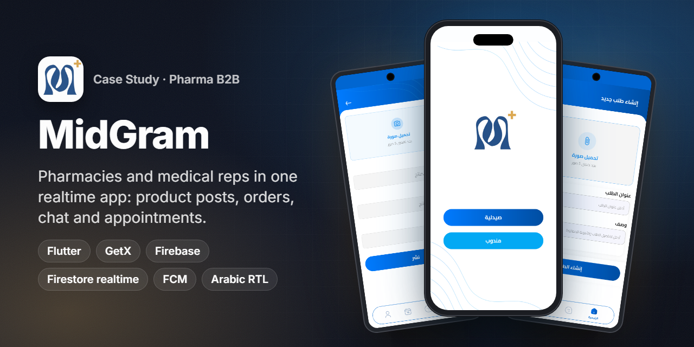
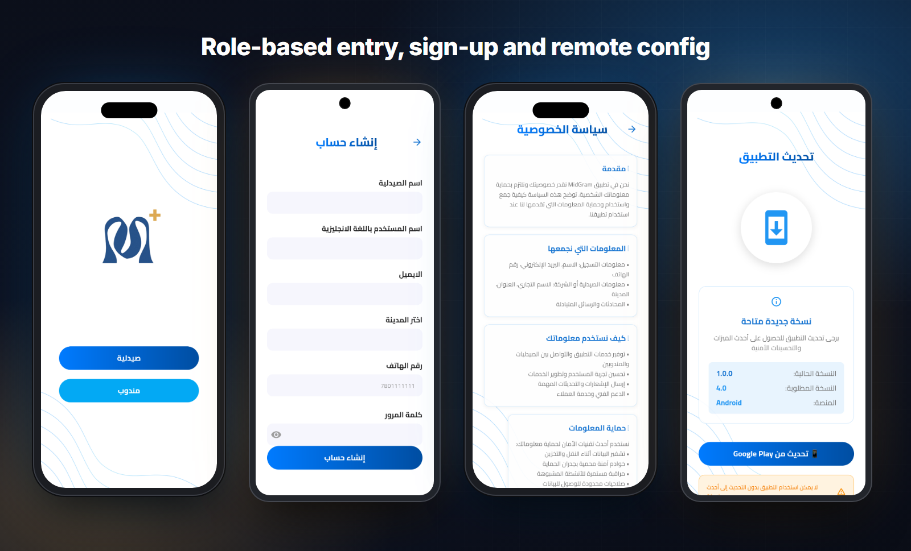
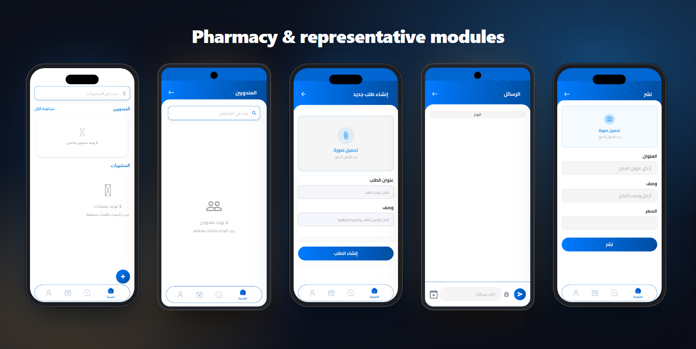
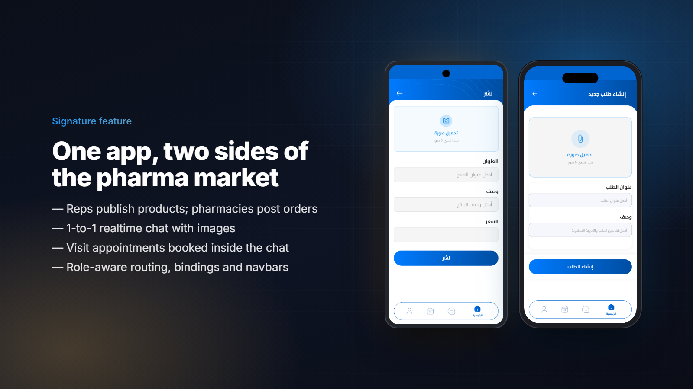
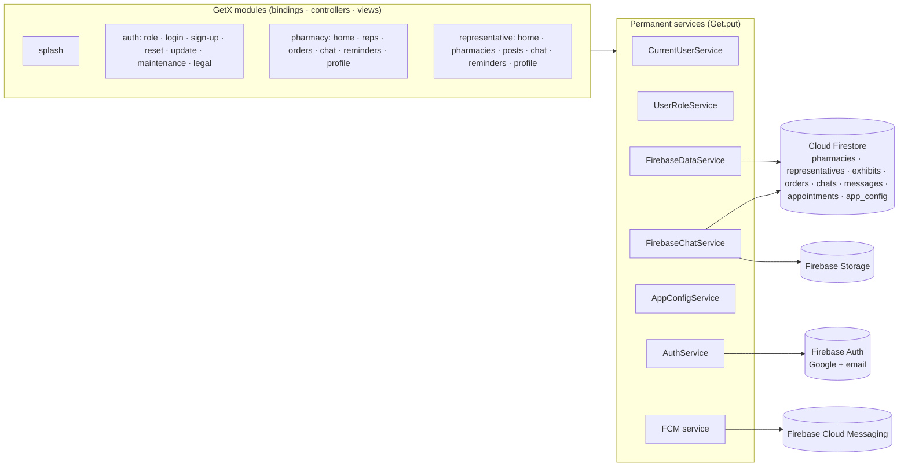

<h1 align="center">MidGram</h1>

<b>A realtime B2B network for pharmacies and medical representatives: product posts, orders, chat and visit appointments in one Arabic-first app.</b>

  
  
  
  
  
  
  

> ℹ️ Case study. The source code belongs to the client and is not included.

## Overview
**MidGram** connects the two sides of the pharmaceutical supply conversation. **Medical representatives** publish their products and reach pharmacies. **Pharmacies** discover reps, post what they need, chat directly and book visits. One app serves both audiences: the user picks a role on first launch and the app switches to a dedicated module for that role.

- **Market:** Iraq. Arabic-only, fully RTL, with an Iraqi city list and phone formats.
- **My role:** Flutter developer. I built the app end-to-end on Firebase: architecture, both role modules, realtime chat & appointments, auth, push notifications and remote configuration.
- **Distribution:** Delivered to the client. It is not on a public store listing at the time of writing.

## The challenge
- Pharmacies and reps coordinate over phone calls and personal messaging apps. Products, orders and visit times get lost in those chats.
- The two roles need **different home screens, navigation and data**, but share chat, appointments, profile and auth. Shipping two separate apps would double the maintenance.
- Messages and appointments must appear **in real time** on both phones, with unread counters and push notifications.
- The client needed control after release: force an update or switch on maintenance mode **without shipping a build**.

## Highlights
**💊 For pharmacies**
- Home feed of representatives and their product posts, with search.
- Representative directory and profile details. Pharmacies can also report a rep.
- **Create orders** (title, details of needed medicines, up to 5 images) and track them under *My Orders*.

**🧑‍💼 For medical representatives**
- Publish product posts (title, description, price, up to 5 images) and manage *My Posts*.
- Browse pharmacies and incoming orders, then open a pharmacy's details and start a chat.

**💬 Shared, realtime**
- **1-to-1 chat** with text and images (camera/gallery), unread counters and read receipts. Each participant can delete a conversation on their own side only.
- **Visit appointments** sent as a chat message with date & time. Both sides see them in a *Reminders* calendar, and either side can cancel.
- FCM push notifications for new messages and appointments.

**🔐 Platform**
- Role selection → Google sign-in or email/password → role-specific sign-up (pharmacy or representative, with city lists and unique-username checks).
- Remote **app configuration** in Firestore: minimum version (force-update screen with a store link), maintenance mode and store URLs.
- Deleted-account handling, privacy policy and terms of service screens, and a WhatsApp support entry for deactivated accounts.

## Screens
Real UI from the app, captured from a Flutter web build. Data screens are shown **empty on purpose**: everything behind login lives in the client's production database, and no demo data was invented.

Role selection (pharmacy / representative) · pharmacy sign-up · privacy policy · remote-config force-update screen

Pharmacy home · representatives directory · create order · chat composer with appointment & image actions · representative "publish product"

## Signature feature

**Two roles, one codebase, one conversation.**

1. On first launch the user chooses **Pharmacy** or **Representative**. A `UserRoleService` stores that choice and every later route is resolved from it (`/pharmacy/...` or `/representative/...`), each with its own GetX **bindings**, controllers and bottom navbar.
2. Reps publish **products** and pharmacies publish **orders**, each with up to 5 images uploaded to Firebase Storage. Each side sees the other's content in its feed.
3. Either side opens a **chat**. `createOrGetChat` reuses an existing conversation between the two participants and reactivates it if one of them had deleted it earlier.
4. Inside the chat, a **visit appointment** is a typed message. Sending it also writes an appointment document, which shows up in both users' *Reminders*, and cancelling it updates both sides in real time.

## Architecture & stack

| Layer | Tech |
|---|---|
| UI | Flutter, `flutter_screenutil`, `flutter_svg`, `google_fonts`, Cairo font, RTL `GetMaterialApp` |
| State, DI & routing | **GetX**: modular `bindings / controllers / views`, `GetPage` routes, `SmartManagement.keepFactory`, permanent services |
| Auth | `firebase_auth` + `google_sign_in`, email/password, role-aware auto-login |
| Data | `cloud_firestore` (realtime streams), `firebase_storage` for images, `cached_network_image` |
| Messaging | `firebase_messaging` push, in-chat appointments |
| Local | `shared_preferences` (role, cache), `package_info_plus` (version gate) |
| Device | `image_picker`, `permission_handler`, `url_launcher` |

## Engineering notes
- **Fast splash, parallel init.** Only Firebase, the cache and a few core services start before `runApp`. Auth, app config and app-init then run **in parallel** with a short minimum splash time, and any failure still navigates forward. Startup stays quick even on slow networks.
- **Role-aware routing.** Auto-login reads the Firebase user, loads the matching profile from `pharmacies` or `representatives` and routes to that module. A missing profile falls back to role selection, and a deleted account goes to a dedicated screen.
- **Remote kill-switches.** `AppConfigService` compares the installed version (`package_info_plus`) with `app_config` in Firestore. It can show a blocking **force-update** screen with the right store link, or a **maintenance** screen, all without a new release.
- **Chat that survives deletes.** Each conversation stores a per-participant status (`active` / `deleted`). Deleting hides the chat only for that user. A new message reactivates it for the recipient, and unread counts are kept per participant.
- **Appointments as first-class messages.** An appointment is sent through the chat service, persisted to its own collection and synced to both users' reminder screens through an integration helper that maps Firestore IDs to local reminders.
- **Arabic-first UI.** The whole app runs RTL with `Locale('ar')`, Cairo typography, Arabic validation messages and Iraqi city lists. Legal pages (privacy / terms) are built in-app.

## Results
- One Flutter app serving **2 user roles** (pharmacies and medical representatives) with shared realtime chat and appointments.
- Fully serverless on **Firebase** (Auth, Firestore, Storage, FCM), with remote force-update and maintenance controls.
- Delivered to the client. No public store listing is available to cite.

## بالعربي
**MidGram** منصة بتربط الصيدليات بالمندوبين الطبيين في العراق. المندوب ينشر منتجاته، والصيدلية تنشر طلباتها وتتواصل مع المندوب في شات لحظي.
من جوه الشات تقدر تحجز موعد زيارة، والموعد بيظهر عند الطرفين في صفحة التذكيرات.
تطبيق واحد بدورين، صيدلية ومندوب. كل دور ليه موديول خاص بيه، مبني بـ GetX (Bindings وControllers وViews).
الباك إند كله على Firebase: Auth وFirestore وStorage وFCM، وفيه تحكم عن بُعد لإجبار التحديث ووضع الصيانة. الواجهة عربي بالكامل RTL.

## Links
- Not publicly listed on the stores. Screens above are real UI captures.
- More of my work: [Portfolio](https://anashaker.github.io/shaker_portfolio/)

---
<h3 align="center">Built by Mahmoud Shaker — Senior Flutter Engineer</h3>

  
  
  
  
  
  
  

